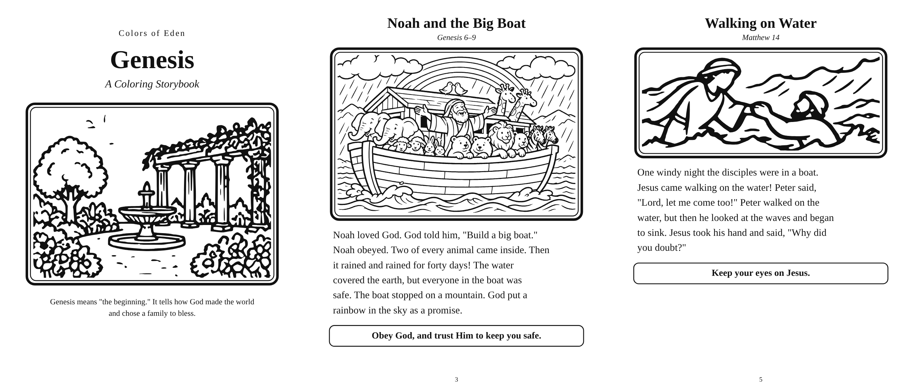

# 🎨 Colors of Eden

A coloring storybook for every book of the Bible, for children ages 5 to 8. Pick a book and it becomes its own coloring book: a cover, then one page per story, each with a drawing to color, a short paragraph a child can read and understand, and the lesson it teaches. Print the whole book or save it as one PDF.

**Try it:** https://theoyanvno.github.io/colors-of-eden/

**Status:** in progress. All 79 books (in SuperBook's Orthodox order) have their stories written, 202 pages in all. For now each page borrows one of the 60 drawings; new drawings for each scene are listed in [PICTURES_NEEDED.md](PICTURES_NEEDED.md) and will replace them as they're made.



## The web page

Pick a book from the menu and its cover and pages appear, with a list of the stories inside. **Print the book or save it as a PDF** prints every page full size on US Letter paper (choose Save as PDF in the print window for a file), each page can be downloaded on its own as an SVG, and **Read in SuperBook** opens the book in [SuperBook](https://theoyanvno.github.io/SuperBook/) to read it in full. Links open a book directly: `?book=Jonah`.

```bash
npm install
npm start      # build and serve at http://localhost:8000
npm test       # the web page's tests, including a check that every page matches the Python one exactly
npm run build  # build into docs/ for GitHub Pages
```

## On Windows

Everything runs on Windows (and macOS or Linux). On Windows, Python is `python` instead of `python3`, and the commands below work as written in the VS Code terminal (PowerShell). Open the folder in VS Code and it offers the recommended extensions (Python, SVG preview); **Terminal > Run Task** has ready-made tasks to install everything, start the web page, run both test suites, list the storybooks, draw one, update the list of pictures needed and list the pictures.

You only need Python and Node.js. Re-tracing the picture sheets (rarely needed) also takes `pip install -r tools/requirements.txt`.

## The command line

```bash
python -m coe books              # every book and how many pages its storybook has
python -m coe book Genesis       # saves the cover and pages in out/genesis/, ready to print on US Letter paper
python -m coe book "1 Samuel"    # any name works: 1 Kingdoms finds the same book
python -m coe pictures           # the 60 drawings
python tools/pictures_needed.py  # rewrites PICTURES_NEEDED.md
```

## Where the words and pictures come from

- **Stories:** each book's stories are retold for young children in short, simple sentences that keep the Bible's core message, each with a one-line lesson. They live in `coe/storybook/<book>.json`, which the Python version and the web page both read.
- **Books:** the same books, order and names as SuperBook, which is the reference for this project: the Old Testament in Orthodox order (with Tobit, Judith, the Maccabees, Wisdom, Sirach, Baruch and the others) and the New Testament. `tests/test_superbook.py` checks the list still matches SuperBook's.
- **Pictures:** 60 drawings (20 animals, 20 places, 20 people of the Middle East) from the author's own picture sheets, kept in `coe/pictures/source/`. `tools/trace_pictures.py` cuts out each drawing, removes its printed name and traces it with [potrace](https://potrace.sourceforge.net/) into smooth outlines that print sharp at full size. Every page also names the scene it should show, and `PICTURES_NEEDED.md` lists them all, so new sheets can be drawn in the same style.

## Run the tests

```bash
python -m unittest   # the Python version (python3 on macOS or Linux)
npm test             # the web page
```

Built with help from AI coding tools; every feature is reviewed and tested before it ships.

## License

MIT. See [LICENSE](LICENSE).
