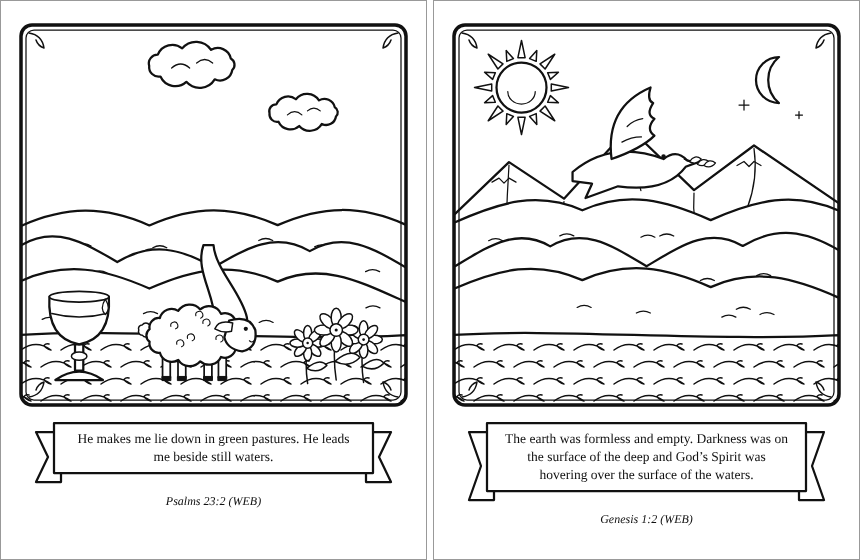

# 🎨 Colors of Eden

Printable coloring pages from any chapter of the Orthodox Bible. Pick a book and a chapter, and Colors of Eden reads the chapter, chooses what to draw from its words (sheep and a quiet stream for Psalm 23, the sun, moon and waters for Genesis 1), and draws an original line-art page with a verse to print and color.

**Status:** in progress. Choosing what to draw and drawing the pages work; the web page and printable PDFs are next.



## Try it

```bash
python -m coe page Psalms 23     # saves out/psalms-23.svg, ready to print on US Letter paper
python -m coe plan Psalms 23     # shows what the page will show
```

```
Psalms 23 (World English Bible (public domain))
Background: path, waves
In front:   cup, sheep, flowers
Verse 2: He makes me lie down in green pastures. He leads me beside still waters.
```

## Where the words and pictures come from

- **Books:** the Eastern Orthodox Bible, in the same books, order and names as [SuperBook](https://theoyanvno.github.io/SuperBook/), which is the reference for this project: 52 Old Testament books in Orthodox order (with Tobit, Judith, the Maccabees, Wisdom of Solomon, Sirach, Baruch and the others) and the 27 of the New Testament. Any common name works, so `1 Samuel` and `1 Kingdoms` find the same book. `tests/test_superbook.py` checks the list still matches SuperBook's.
- **Text:** the World English Bible, a public-domain translation, from [bible-api.com](https://bible-api.com/), the same source SuperBook reads. Each chapter is fetched once and cached in `.coe-cache/`. Genesis 1 and Psalm 23 are included so it works offline. Like SuperBook, it can't offer the Letter of Jeremiah, Psalm 151 or the Greek additions to Esther and Daniel, which that free source doesn't have.
- **Pictures:** every drawing is original, made in code (`coe/art.py`) in a storybook style: a framed scene with layered hills, a sun, moon, stars, clouds, mountains, waves and a winding path behind; trees, flowers, sheep, a dove, fish, a boat, a crown, a lamp, a cup and a heart in front, with texture lines like bark, wool and ripples, and the verse on a ribbon. No clip art or traced images. Every shape is a closed outline, so each area can be colored in.

## Run the tests

```bash
python -m unittest
```

Built with help from AI coding tools; every feature is reviewed and tested before it ships.

## License

MIT. See [LICENSE](LICENSE).
